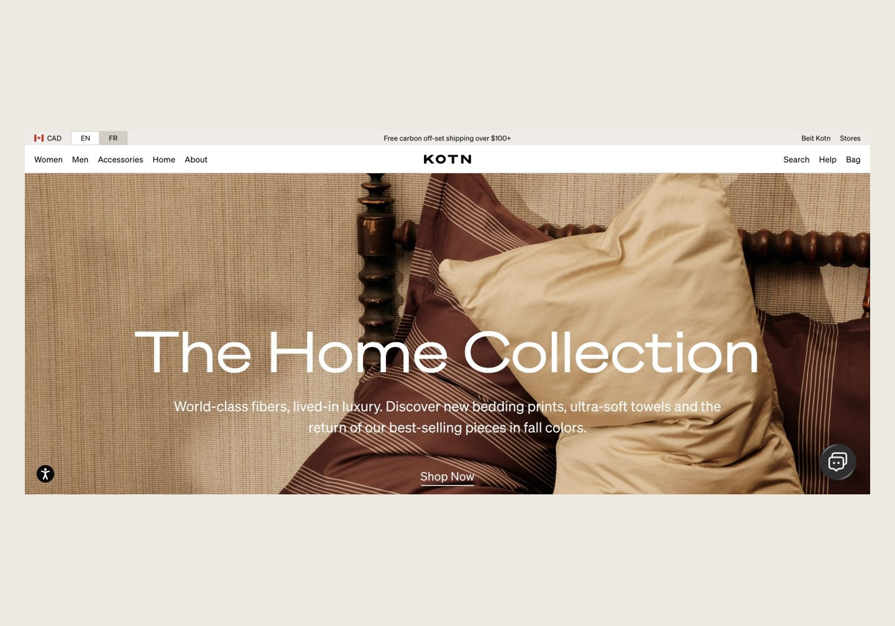
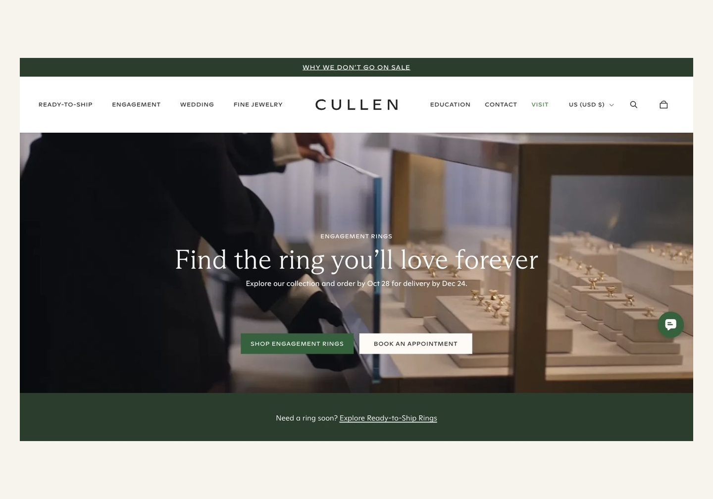
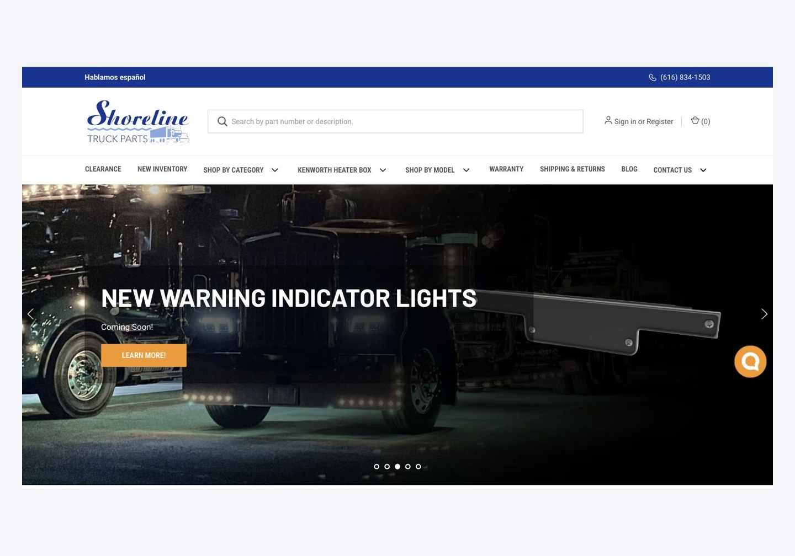
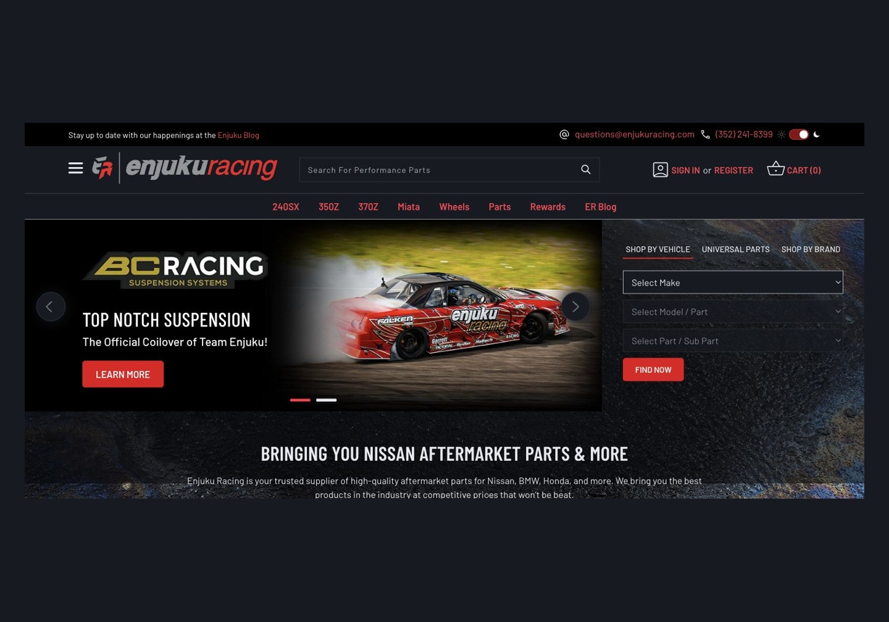
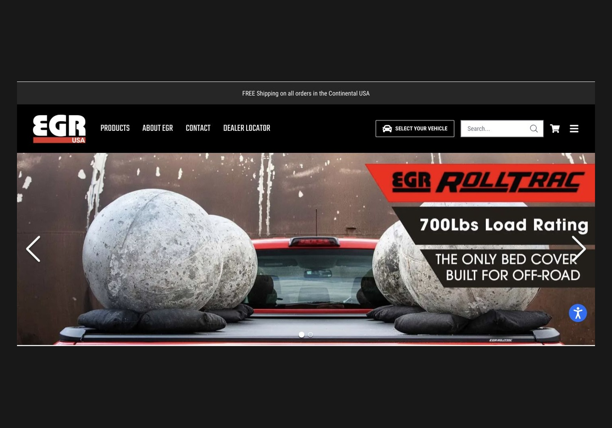

<strong>Theme customization · Custom sections · Responsive storefronts · Bug fixes</strong>

<a href="https://www.upwork.com/freelancers/~01985e001b04bd49be">Work with me on Upwork</a> · <a href="https://github.com/tauheedashraf2007-art/tauheedashraf2007-art/blob/main/PORTFOLIO.md">Browse the storefront portfolio</a>

## Hi, I'm Tauheed

I help store owners customize Shopify and BigCommerce themes, improve mobile layouts, and resolve storefront issues. My focus is practical ecommerce development: clear product pages, reusable sections, and a consistent shopping experience across devices.

## How I can help

| Shopify | BigCommerce | Frontend & store maintenance |
| --- | --- | --- |
| Liquid theme customization | Stencil theme customization | HTML, CSS & JavaScript |
| Custom sections and templates | Page Builder widgets and sections | Responsive layout fixes |
| Product and collection pages | Product and category layouts | Storefront debugging |
| Store setup and app configuration | Store setup and integrations | Performance and tracking setup |

**Also work with:** WordPress, WooCommerce, Google Analytics 4, Google Tag Manager and Meta Pixel.

## Selected storefront showcases

<table>
<tr>
<td width="50%"> <strong>Kotn</strong> Clothing & home</td>
</tr>
<tr>
<td> <strong>Cullen Jewellery</strong> Fine jewellery</td>
<td> <strong>Shoreline Truck Parts</strong> Truck parts & accessories</td>
</tr>
<tr>
<td> <strong>Enjuku Racing</strong> Automotive parts</td>
<td> <strong>EGR USA</strong> Vehicle accessories</td>
</tr>
</table>

**[Explore all 22 website showcases →](https://github.com/tauheedashraf2007-art/tauheedashraf2007-art/blob/main/PORTFOLIO.md)**

Visual storefront showcases. Brand assets belong to their respective owners; client theme source code is not included in this repository.

## My working process

1. **Understand the task:** review the store URL, screenshots and requested changes.
2. **Agree on scope:** define the task list, timeline and included revisions.
3. **Build and review:** share progress and check the agreed changes on desktop and mobile.
4. **Hand over clearly:** explain the updates and any follow-up maintenance needs.

## Let's work on your store

Available for individual fixes, theme customization and ongoing store maintenance.

**[Send your store URL and project brief on Upwork →](https://www.upwork.com/freelancers/~01985e001b04bd49be)**
